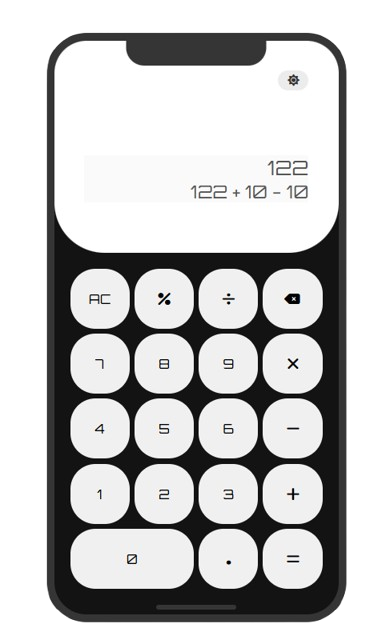

# JavaScript Calculator

A basic calculator built with HTML, CSS, and vanilla JavaScript to practice functions, programming logic, DOM manipulation, and event handling.

The interface features an iPhone-inspired design, theme switching, and a display for the last calculated expression.

## Preview



## Project Goal

Build a calculator step by step while understanding how user interactions, calculation logic, and interface updates work together.

This is a learning project. The current implementation prioritizes practicing JavaScript fundamentals, with further improvements planned for validation and calculation handling.

## Implemented Features

- Addition, subtraction, multiplication, and division.
- Decimal input using a dot.
- Initial display value of `0`, replaced when entering a number.
- Support for a negative number at the beginning of an expression.
- Spaces between numbers and arithmetic operators.
- Multiplication displayed as `×`.
- Replacement of consecutive operators instead of appending them.
- Clear button that resets both the display and history.
- Delete button that removes the last character.
- Display of the last successfully evaluated expression.
- Automatic horizontal scrolling when entering long expressions.
- Light theme toggle with sun and moon icons.
- Button press animation.
- Two-column zero button and two-row equals button.
- Mobile media query that reduces the header height.

## Technologies

- **HTML5** — interface structure and calculator controls.
- **CSS3** — layout, colors, themes, and interactions.
- **JavaScript** — input handling, calculations, and DOM updates.
- **Font Awesome** — interface icons.
- **Google Fonts** — Orbitron typography.

No JavaScript frameworks or build tools are required.

## JavaScript Functions

| Function | Responsibility |
| --- | --- |
| `insertToDisplay(data)` | Inserts numbers and operators, formats multiplication, replaces consecutive operators, and scrolls the display to the latest input. |
| `clearDisplay()` | Resets the display to `0` and clears the previous expression. |
| `deleteDisplay()` | Removes the last character and restores `0` when the display becomes empty. |
| `result()` | Converts the multiplication symbol, evaluates the expression, and updates the result and history. |
| `toggleThemes()` | Adds or removes the light theme class and updates the theme button icon. |

## JavaScript Concepts and Methods

### Variables and State

- `const` stores DOM references and values used during operations.
- `let` stores the current theme state.
- Arrays define the supported arithmetic operators.
- `if`, `else if`, and `else` control input behavior.
- The ternary operator selects `×` when the multiplication button sends `*`.

### DOM Manipulation

- `document.getElementById()` selects the display, history, and theme button.
- `document.getElementsByClassName()` selects the calculator container.
- `.value` reads and updates input contents.
- `.classList.add()` and `.classList.remove()` switch the theme class.
- `.innerHTML` updates the theme button icon.
- `.scrollLeft` and `.scrollWidth` keep the latest input visible.

### Events

- HTML `onclick` handlers connect calculator buttons to JavaScript functions.
- `addEventListener("click", ...)` handles theme switching.

### String and Array Methods

- `trimEnd()` removes trailing spaces before checking the last operator.
- `slice()` reads or removes characters.
- `includes()` checks whether a value is a supported operator.
- `replaceAll()` converts the displayed `×` symbol into JavaScript's `*` operator.

### Expression Evaluation

The current version uses `eval()` to evaluate arithmetic expressions.

For example:

```js
const expression = "9 × 3";
const calculation = expression.replaceAll("×", "*");
const calculatedResult = eval(calculation);
```

The displayed expression remains `9 × 3`, while the evaluated expression is `9 * 3`.

`eval()` executes JavaScript code, not just arithmetic. It is used here as an initial learning approach. Replacing it with an arithmetic parser or dedicated calculation logic is a planned improvement.

### Error Handling

`try...catch` displays `"error"` when expression evaluation throws an exception.

This does not validate every invalid mathematical operation. For example, division by zero can return `Infinity` without throwing an exception.

## CSS Concepts

- Custom properties for shared colors and theme values.
- Flexbox for the calculator and header layout.
- CSS Grid for the keypad.
- `::before` and `::after` for the decorative phone details.
- Absolute positioning for the top notch and bottom bar.
- `:active`, `transform`, and `transition` for button feedback.
- Media queries for smaller screens.
- `prefers-reduced-motion` to disable button transitions when requested.
- `appearance` and `-webkit-appearance` to customize native controls.

## Example Usage

1. Enter `9`.
2. Select multiplication.
3. Enter `3`.
4. Select equals.

The history displays:

```text
9 × 3
```

The main display shows:

```text
27
```

Selecting `AC` clears the history and resets the display to `0`.

## Running Locally

1. Clone the repository:

```bash
git clone https://github.com/adoniasgoesw/javascript-calculator.git
```

2. Open the project folder:

```bash
cd javascript-calculator
```

3. Open `index.html` in your browser, or serve the project with a local development server such as VS Code Live Server.

No dependency installation or environment variables are required.

Google Fonts and Font Awesome are loaded from external services and require an internet connection.

## Current Limitations

- Expressions are evaluated using `eval()`.
- Division by zero and non-finite results are not explicitly handled.
- Multiple decimal points within the same number are not blocked.
- Starting a new calculation after a result or error needs improved input handling.
- The history shows only the last successfully evaluated expression.
- The theme resets when the page reloads.
- Percentage calculations are not supported.
- The fixed calculator dimensions may not fit short screens or landscape orientation.
- There is no dedicated keyboard input handler.
- Automated tests are not configured.

## Planned Improvements

- Replace `eval()` with dedicated arithmetic evaluation.
- Validate decimal input.
- Handle division by zero and invalid results.
- Improve input behavior after results and errors.
- Save the selected theme with `localStorage`.
- Improve the layout for short screens and landscape orientation.
- Add keyboard shortcuts.
- Add tests for calculation and input rules.
- Review accessibility and browser compatibility.

## Project Status

🚧 In development.

The basic interface and calculation interactions are implemented. Input validation, calculation handling, and responsive behavior are being improved.

## Author

[Adonias Goes](https://github.com/adoniasgoesw)